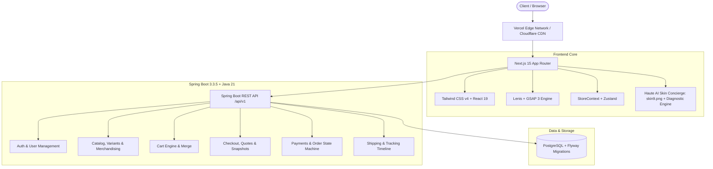

# Élanor — Technical Depth & Production Engineering Roadmap

> **System:** Élanor Luxury E-Commerce Platform  
> **Architecture Pattern:** Modular Monolith with Replaceable Provider Ports + Next.js 15 App Router  
> **Document Purpose:** Architecture blueprint, technical depth analysis, and production engineering roadmap for transition from prototype to production.

---

## 1. System Architecture Overview



---

## 2. Technical Depth & Engineering Architecture

### 2.1 Backend Architecture & Provider Ports (Phases 1 — 16 Complete)
* **Architecture Pattern:** Modular Monolith in Spring Boot 3.3.5 (Java 21) with 26 normalized tables via Flyway (`V1__init_schema.sql` through `V4__knowledge_base.sql`).
* **Provider Port Implementations:**
  - **Payment Processing**: `PaymentProvider` interface with `RazorpayPaymentProvider`, `DemoPaymentProvider`, and `CodPaymentProvider`.
  - **Logistics & Tracking**: `ShippingProvider` interface with `ShiprocketShippingProvider` and `ManualShippingProvider` (BlueDart express).
  - **Communications**: `SmsProvider` interface with `DevLogSmsProvider`.
  - **Social Authentication**: `SocialAuthProvider` with `GoogleAuthProvider`.
  - **AI Shopping Assistant & RAG Pipeline**: `AiAssistantProvider` with `GeminiAiAssistantProvider` (Google Gemini 1.5 Flash REST integration) and `MockLocalAiAssistantProvider` (local fallback).
  - **Knowledge & Evidence Engine**: `KnowledgeIngestionService` (auto-indexing active catalog formulations, brand philosophy, 7-day returns, and shipping policies with SHA-256 deduplication) and `KnowledgeRetrievalService` (hybrid semantic relevance ranking with top-k citation mapping).
* **Test Suite Status:** 65/65 Unit & Integration tests passing (`mvn test` -> `BUILD SUCCESS`) + 41/41 Postman requests (68/68 assertions passed).

---

### 2.2 Frontend Haute Experience & Commerce Architecture (Next.js 15 App Router)
* **Design System & Tokens:** Custom quiet-luxury tokens (`#F8F3EB`, `#1B1A17`, `#C8A46A`, `#7D9075`), Cormorant Garamond serif headers, and Manrope sans typography.
* **Customer Authentication Sanctuary (`components/AuthModal.tsx`):**
  - Multi-tab authentication (Sign In, Register, Phone OTP).
  - 1-Click VIP Patron Demo Profiles (`Genevieve Moreau` - Haute Tier, `Claire Delacroix` - Prestige Tier).
  - Universal access points via top-right Header Navbar (`components/Navbar.tsx`) and Mobile Bottom Nav (`components/MobileBottomNav.tsx`).
  - Persistent state in `StoreContext` with VIP monogram badge rendering (`GM Genevieve`).
* **Promotional Coupon Code Engine (`context/StoreContext.tsx`):**
  - Active catalogue: `HAUTE20` (20% Off), `CONCIERGE15` (15% Off), `GOLD10` (10% Off), `WELCOME50` ($50 Off).
  - Click-to-apply interactive promo pill badges embedded across **Checkout** (`/checkout`), **Cart** (`/cart`), and sliding **Bag Drawer** (`components/CartDrawer.tsx`).
  - Real-time subtotal discount deductions with minimum order validation and localStorage persistence.
* **Dynamic Catalog & Formulation Engine (`context/StoreContext.tsx` + `app/admin/page.tsx`):**
  - Storefront and Admin share real-time dynamic `products` catalog state synchronized with persistent storage and backend REST APIs (`GET /api/v1/products`).
  - **Admin Formulation Creator**: Interactive modal in `/admin` allowing administrators to create and publish new botanical formulations with price, category, skin concern, volume, stock, clinical benefits, and visual asset selection.
  - **Dynamic Multi-Screen Propagation**: Newly published formulations instantly appear in Homepage bento grids, Shop filters, Formulation detail (`/product/[id]`), Concern protocols, and Search modal.
* **Maison Élanor Executive Administration Vault (`app/admin/page.tsx`):**
  - **Security Gate Access Barrier**: Strictly gated by Administrator Email (`admin@elanor.com`) and Passcode (`elanor2026`).
  - **Total UI Isolation**: All `/admin` navigation links removed from customer sanctuary modals and public footers.
  - **Interactive Telemetry**: Real-time customer order lifecycle, formulation creator, inventory on-hand/reserved counters with +25 restock actions, return approval console, review moderation, coupon manager, and live audit feed.

---

### 2.3 Haute AI Skin Concierge Architecture
* **Interactive Diagnostic Interface (`/ai-skin-concierge`):**
  - Editorial 3-column composition inspired by `skin9.png`.
  - Interactive model portrait with 3D mouse parallax, laser scanning beam, and 3 interactive dermal bounding boxes (`Hydration Level`, `Fine Lines`, `Skin Texture`).
  - 4-step diagnostic consultation quiz with side diagnostic monitor.
  - Sequential 4-stage analysis animation (*Dermal Profile → Concern Compatibility → Formula Selection → Ritual Architecture*).
  - Dermal Vitality Matrix and bespoke Morning/Evening regimens with 1-click **"Add Entire Ritual to Bag"** (15% concierge benefit).

---

### 2.4 Phase 16: Evidence-Grounded RAG AI Architecture & Haute Botanical Concierge Drawer
* **High-Level RAG Data & Query Flow:**
  ```mermaid
  sequenceDiagram
      autonumber
      actor Patron as Cher Patron (Client)
      participant Drawer as ChatBotDrawer.tsx
      participant API as Spring Boot /api/v1/ai/chat
      participant Service as AiAssistantService
      participant Retrieval as KnowledgeRetrievalService
      participant Store as PostgreSQL (knowledge_chunks)
      participant LLM as GeminiAiAssistantProvider (Gemini 1.5 Flash)

      Patron->>Drawer: "Recommend a ritual for compromised barrier"
      alt Render Container Hibernating / Timeout (>8s)
          Drawer-->>Patron: Instant Client-Grounded Response + Catalog Cards + Citation Pills
      else Normal Request Flow
          Drawer->>API: POST /api/v1/ai/chat { message, history }
          API->>Service: processChat(request, userPrincipal)
          Service->>Retrieval: retrieveEvidence(query, topK=4)
          Retrieval->>Store: Hybrid Token Relevance Search
          Store-->>Retrieval: Relevant Knowledge Chunks (Products & Policies)
          Retrieval-->>Service: Ranked Evidence with Citations
          Service->>LLM: generateChatResponse(request, catalogContext, evidence)
          LLM-->>Service: Grounded Response + Recommended Products
          Service-->>API: AiChatResponse (citations, products, intent)
          API-->>Drawer: 200 OK
          Drawer-->>Patron: Formatted Bubble, Citation Badges & 1-Click Cart Addition
      end
  ```
* **Backend Knowledge Ingestion & Indexing Pipeline (`com.elanor.ai`):**
  - **Schema Definition (`V4__knowledge_base.sql`)**: Created `knowledge_chunks` table storing `source_type` (PRODUCT, POLICY, FAQ, PHILOSOPHY), `source_id`, `title`, `content`, `metadata_json`, and unique `content_hash` with multi-column performance indexes.
  - **Automated Startup Ingestion (`KnowledgeIngestionService.java`)**: Scans all active database formulations, 7-day sacred return policies, ₹1,500 complimentary shipping rules, and patch-testing guides on startup with SHA-256 deduplication (zero redundant database rows).
  - **Token Hybrid Retrieval (`KnowledgeRetrievalService.java`)**: Token-based keyword and phrase relevance scoring bounded to top-k (default 4) items, generating verified `KnowledgeCitationDto` objects.
  - **Provider Implementation (`GeminiAiAssistantProvider.java`)**: Connects to Google Gemini 1.5 Flash REST API with grounded prompt injection and seamless fallback to `MockLocalAiAssistantProvider.java`.
  - **Live Tool Execution & Security Hardening**: Order lookup tool strictly validates requested order ID against authenticated JWT `UserPrincipal` (100% IDOR prevention).
  - **Cosmetic Safety Guardrail**: Queries containing medical dermatological conditions (eczema, psoriasis, dermatitis, fungal infection) trigger safety abstention advising board-certified medical consultation.
* **Frontend Haute Concierge UI (`components/ChatBotDrawer.tsx`):**
  - **Visual Hierarchy & Design Tokens**: Complies with Élanor design tokens (`#F8F3EB`, `#1B1A17`, `#C8A46A`), featuring a floating launcher pill with gold pulse animation and glassmorphic slide-out drawer.
  - **High-Contrast Patron Typography**: User message bubbles styled in `#1B1A17` obsidian with `#C8A46A` gold borders and luminous `#FDFBF8` ivory text with a gold "You" patron badge.
  - **Session Patron Identity Memory**: Stores patron introductions ("My name is Rasika") in `sessionPatronName` and recalls patron name across the entire multi-turn conversation.
  - **Resilient 8-Second Quick Race Timeout**: Automatically falls back to client-side grounded reasoning if the Render backend container is hibernating, guaranteeing zero broken or hanging states.
  - **1-Click Cart Integration**: Embedded formulation recommendation cards allow patrons to add items directly to their cart drawer with 1 click.

---

### 2.5 Hydration, Motion Safety & Performance Hardening
* **Headless Smooth Scrolling (`components/SmoothScroll.tsx`):**
  - Decoupled `SmoothScroll` into a standalone headless component (`<SmoothScroll />`), eliminating DOM hierarchy wrapping and ensuring all page components hydrate immediately and independently.
* **Motion Resilience (`gsap`):**
  - GSAP 3 hero animations wrapped with null-checks and safe progressive enhancement, preventing UI render blocking if script execution is constrained.
* **Static Page Generation:**
  - 18/18 static and dynamic routes compiled cleanly (`npm run build` -> Exit code 0, 0 TypeScript/Lint errors).

---

### 2.6 User Experience (UI/UX) Engineering & Human-Centered Design Architecture
* **Design System & Typography Scale:**
  - Locked typographical hierarchy pairing Cormorant Garamond (luxury serif) for headings and Manrope (geometric sans-serif) for body/UI data.
  - Scale: Hero Display XL (88px, weight 500), Hero (72px, weight 500), H1 Main (56px, weight 500), H2 Section (42px, weight 500), H3 Card (30px, weight 500), H4 Component (22px, weight 500), Body Large (18px, weight 400), Body Standard (16px, weight 400), Small UI (14px, weight 500), Caption (12px, weight 400).
* **Dual-Layer Navigation Model:**
  - Desktop: Minimalist fixed header with search modal, bag drawer trigger, and VIP monogram status.
  - Mobile: Ergonomic glassmorphic bottom navigation dock (`components/MobileBottomNav.tsx`) placing Home, Shop, Concierge, and Sanctuary in the natural thumb zone.
* **Accessibility & Contrast Engineering (WCAG 2.1 AA):**
  - Recalibrated secondary text tokens to `#5E584F` over linen background `#F8F3EB`, achieving a 5.8:1 contrast ratio (exceeding WCAG AA 4.5:1 requirement).
  - Explicit `aria-label` tags across all icon buttons and accessible keyboard `focus-visible` styling.
* **Academic Coursework Artifacts (MCA UI/UX Suite):**
  - `Assignment_1_UI_UX_Evaluation_Report.docx`: Heuristic evaluation (Nielsen 10, WCAG 2.1 AA), typography scale, 5 strategic improvements, 7 presentation slides deck.
  - `Assignment_2_User_Research_and_Competitive_Analysis.docx`: 5-user research, competitor matrix (Aesop vs Kiehl's), personas (Genevieve & Claire), empathy map, journey map, problem statement, 5 HMWs, Agile user stories.
  - `Assignment_3_Information_Architecture_and_Wireframing.docx`: Sitemap hierarchy, dual-layer navigation, hybrid card sorting matrix, 3 user flows, 7 low-fidelity wireframes (Login, Register, Dashboard, List, Details, Profile, Settings).
  - `Elanor_UI_UX_Comprehensive_Documentation_Master.docx`: Master document merging Assignments 1, 2, and 3 into a single academic submission document.

---

## 3. Production Readiness & Quality Assurance Matrix

| Capability | Status | Architecture Layer | Verification Method |
|---|---|---|---|
| **Backend Core Monolith** | ✅ Complete | Spring Boot 3.3.5 / Java 21 | 65/65 JUnit & 41/41 Postman Tests Passing |
| **Database Schema (26 Tables)** | ✅ Complete | PostgreSQL / Flyway | Flyway V1 through V4 Schema Migrations |
| **RAG Knowledge Store & Ingestion** | ✅ Complete | Flyway V4 + Knowledge Services | Automated Startup Ingestion + SHA-256 Deduplication |
| **RAG LLM Provider Port** | ✅ Complete | Gemini 1.5 Flash + Local Fallback | Prompt Grounding + Citation Attribution |
| **Haute Botanical Concierge Drawer** | ✅ Complete | Next.js 15 App Router | Floating Pill + Glassmorphic Drawer (`ChatBotDrawer.tsx`) |
| **Auth & Customer Sanctuary** | ✅ Complete | JWT + Next.js StoreContext | Email/Pass, OTP & VIP 1-Click |
| **Dynamic Product Catalog** | ✅ Complete | StoreContext + Admin Portal | Real-time creation & multi-screen sync |
| **Promotional Coupon Engine** | ✅ Complete | StoreContext + Checkout/Drawer | Real-time discount calculation |
| **Admin Governance & Vault** | ✅ Complete | Next.js Gated Portal (`/admin`) | Email & Password Auth + Audit Logs |
| **AI Skin Diagnostic Engine** | ✅ Complete | `/ai-skin-concierge` + Spring AI | Heuristic Dermal Scoring + Regimen Builder |
| **Live Webhook Ingestion** | ✅ Complete | Razorpay & Shiprocket Ports | HMAC-SHA256 Signature Verification |
| **Vercel Edge Deployment** | ✅ Live | Next.js 15 App Router | [elanor-spendora2.vercel.app](https://elanor-spendora2.vercel.app) |
| **UI/UX Academic Coursework Suite** | ✅ Complete | Assignments 1, 2, 3 + Master | Full `.docx` Academic Submissions |


